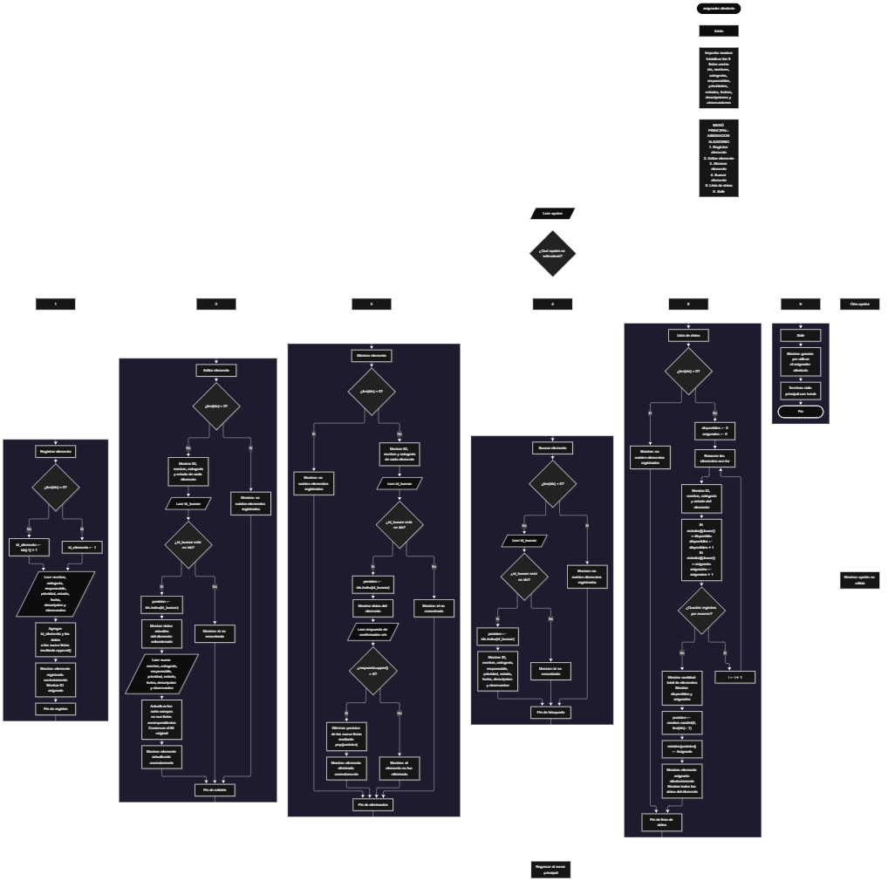

Este proyecto, llamado <b>asignador aleatorio</b>, fue desarrollado en <b>python</b> como un ejercicio práctico para fortalecer la lógica de programación mediante la creación de un sistema de gestión y asignación de elementos desde la consola. El programa cuenta con un menú principal de seis opciones que permite <b>registrar, editar, eliminar, buscar y listar elementos, además de salir del sistema</b>. Cada elemento almacena información como el nombre, la categoría, el responsable, la prioridad, el estado, la fecha de registro, la descripción y las observaciones. Para organizar los registros, se utilizan nueve listas relacionadas que mantienen los datos de cada elemento en posiciones correspondientes. Durante su desarrollo se aplicaron conceptos fundamentales de programación, como variables, listas, estructuras condicionales, ciclos repetitivos y generación de números aleatorios. Además, el sistema calcula estadísticas de los elementos disponibles y asignados, y selecciona aleatoriamente un elemento para cambiar su estado a asignado. Este proyecto permite poner en práctica los conocimientos adquiridos en Python y sirve como base para desarrollar sistemas de gestión más avanzados.

<h2 align="center">⚙️ Funcionamiento del menú principal</h2>

### ➕ Registrar elemento

La opción <b>1) registrar elemento</b> permite incorporar un nuevo elemento al sistema. Antes de registrar sus datos, el programa comprueba si la lista <b>ids</b> está vacía mediante la condición <b>len(ids) == 0</b>. Si no existen registros, asigna el identificador inicial <b>1</b>; de lo contrario, calcula el nuevo identificador sumando uno al último valor almacenado mediante <b>ids[-1] + 1</b>. Después, solicita el <b>nombre, categoría, responsable, prioridad, estado, fecha, descripción y observación</b>. Los datos se almacenan en sus respectivas listas utilizando el método <b>append()</b>, manteniendo la correspondencia entre las posiciones. Finalmente, muestra el mensaje <b>"elemento registrado correctamente."</b> e informa el identificador asignado. La prioridad se solicita con las opciones alta, media o baja, mientras que el estado se solicita como disponible o asignado; sin embargo, el código actual no valida que los valores introducidos pertenezcan exclusivamente a esas opciones.

### ✏️ Editar elemento

La opción <b>2) editar elemento</b> permite modificar la información de un elemento registrado. Primero, el programa comprueba si existen registros mediante <b>len(ids) == 0</b>. Si no hay elementos, muestra el mensaje <b>"no existen elementos registrados."</b>. En caso contrario, utiliza un ciclo <b>for</b> para presentar los identificadores, nombres, categorías y estados de los elementos existentes. Después, solicita el identificador que se desea editar y comprueba si se encuentra en la lista <b>ids</b>. Si existe, obtiene su posición mediante <b>ids.index(id_buscar)</b>, muestra algunos de sus datos actuales y solicita los nuevos valores del nombre, categoría, responsable, prioridad, estado, fecha, descripción y observación. Cada valor se actualiza directamente en la posición correspondiente de su lista, mientras que el identificador original se conserva. Finalmente, muestra el mensaje <b>"elemento actualizado correctamente."</b>. Si el identificador no existe, presenta el mensaje <b>"id no encontrada."</b>.

### 🗑️ Eliminar elemento

La opción <b>3) eliminar elemento</b> permite eliminar un registro mediante su identificador. Antes de comenzar, el programa comprueba si existen elementos almacenados. Si la lista está vacía, muestra el mensaje <b>"no existen elementos registrados."</b>. Si hay registros, presenta una lista con el identificador, nombre y categoría de cada elemento. Después, solicita el identificador que se desea eliminar y comprueba si se encuentra en <b>ids</b>. Cuando lo encuentra, obtiene su posición con <b>ids.index(id_buscar)</b> y muestra los datos básicos del elemento seleccionado. A continuación, solicita una confirmación mediante la pregunta <b>"¿desea eliminar este elemento? (s/n):"</b>. Si la respuesta convertida a mayúsculas mediante <b>respuesta.upper()</b> es igual a <b>"S"</b>, elimina la posición correspondiente de las nueve listas utilizando <b>pop(posicion)</b>. Finalmente, muestra el mensaje <b>"elemento eliminado correctamente."</b>. Si la respuesta no es <b>"S"</b>, informa que el elemento no fue eliminado. Cuando el identificador no existe, muestra <b>"id no encontrada."</b>.

### 🔎 Buscar elemento

La opción <b>4) buscar elemento</b> permite localizar un elemento mediante su identificador. Primero, el programa comprueba si existen registros. Si no hay elementos almacenados, muestra el mensaje <b>"no existen elementos registrados."</b>. En caso contrario, solicita el identificador que se desea buscar y verifica si está presente en la lista <b>ids</b>. Cuando encuentra una coincidencia, utiliza <b>ids.index(id_buscar)</b> para obtener la posición correspondiente y muestra toda la información del elemento: identificador, nombre, categoría, responsable, prioridad, estado, fecha, descripción y observación. Si el identificador no está registrado, presenta el mensaje <b>"id no encontrada."</b>. Esta operación permite consultar individualmente los datos de un elemento sin modificar su información.

### 📋 Lista de datos y asignación aleatoria

La opción <b>5) lista de datos</b> permite visualizar los elementos registrados y consultar las estadísticas del sistema. Primero, comprueba si existen registros. Si no hay elementos, muestra el mensaje <b>"no existen elementos registrados."</b>. Si existen, inicializa los contadores <b>disponibles</b> y <b>asignados</b> en cero. Después, recorre las listas mediante un ciclo <b>for</b> y muestra el identificador, nombre, categoría y estado de cada elemento. Durante el recorrido, utiliza <b>estados[i].lower()</b> para contar los elementos cuyo estado coincide con <b>"disponible"</b> o <b>"asignado"</b>, sin distinguir entre mayúsculas y minúsculas. Al finalizar, muestra la cantidad total de elementos y los contadores de disponibles y asignados. Posteriormente, utiliza <b>random.randint(0, len(ids) - 1)</b> para seleccionar aleatoriamente una posición válida de la lista. El estado del elemento seleccionado se cambia a <b>"Asignado"</b> y se muestra toda su información. Esta operación combina el listado, el cálculo de estadísticas y la asignación aleatoria. La selección no excluye los elementos que ya están asignados, por lo que un mismo elemento puede seleccionarse nuevamente.

### 🚪 Salir del menú principal

La opción <b>6) salir</b> permite finalizar la ejecución del programa. Cuando el usuario selecciona esta opción, se muestra el mensaje <b>"gracias por utilizar el asignador aleatorio."</b> y se ejecuta la instrucción <b>break</b>, que termina el ciclo principal <b>while True</b>. De esta manera, el usuario puede realizar las operaciones disponibles y salir del sistema cuando lo desee. Si introduce una opción distinta de las comprendidas entre <b>1</b> y <b>6</b>, el programa muestra el mensaje <b>"opción no válida."</b> y vuelve a presentar el menú.

<h2 align="center">🧠 Temas aplicados en el proyecto</h2>

### 📦 Variables

En este proyecto se utilizan variables para almacenar los datos introducidos por el usuario, controlar los identificadores, localizar registros, administrar la posición de cada elemento, procesar la confirmación de eliminación y calcular las estadísticas. También se emplean variables para seleccionar y actualizar aleatoriamente el estado de un elemento. Cada variable cumple una función dentro de las operaciones de gestión.

🔢 **Opcion:** Almacena la opción introducida por el usuario en el menú principal.

🆔 **Id_elemento:** Almacena el identificador que se asignará al nuevo elemento.

🔎 **Id_buscar:** Almacena el identificador que el usuario desea editar, eliminar o buscar.

📍 **Posicion:** Representa el índice del elemento localizado dentro de las listas.

📝 **Nombre, categoria, responsable, prioridad, estado, fecha, descripcion y observacion:** Almacenan temporalmente los datos introducidos durante el registro de un elemento.

❓ **Respuesta:** Almacena la respuesta del usuario para confirmar o cancelar la eliminación.

📊 **Disponibles:** Cuenta los elementos cuyo estado es disponible durante el recorrido de las listas.

📊 **Asignados:** Cuenta los elementos cuyo estado es asignado durante el recorrido de las listas.

🔄 **I:** Funciona como variable de control del ciclo utilizado para recorrer los registros.

🎲 **Random:** Es el módulo importado que proporciona la función utilizada para seleccionar aleatoriamente un elemento.

### 🗃️ Listas

El programa utiliza nueve listas relacionadas para almacenar los datos de los elementos registrados. Cada posición representa un registro y mantiene correspondencia con la misma posición de las demás listas. Por ejemplo, la información de un elemento ubicado en la posición <b>0</b> se distribuye entre <b>ids[0], nombres[0], categorias[0], responsables[0], prioridades[0], estados[0], fechas[0], descripciones[0]</b> y <b>observaciones[0]</b>. Esta organización permite recorrer, buscar, modificar y eliminar registros utilizando un índice común. Las listas de Python son dinámicas, por lo que el código no establece una capacidad máxima fija de elementos.

🆔 **Ids:** Almacena los identificadores de los elementos registrados.

📝 **Nombres:** Almacena los nombres de los elementos.

🗂️ **Categorias:** Almacena las categorías de los elementos.

👤 **Responsables:** Almacena las personas responsables de los elementos.

⚡ **Prioridades:** Almacena las prioridades registradas.

🔖 **Estados:** Almacena los estados de los elementos, como disponible o asignado.

📅 **Fechas:** Almacena las fechas de registro.

📄 **Descripciones:** Almacena las descripciones de los elementos.

📌 **Observaciones:** Almacena las observaciones adicionales de cada elemento.

### 🔀 Estructuras condicionales

En este proyecto se utilizan las estructuras condicionales <b>if, elif y else</b> para controlar las opciones del menú, comprobar si existen elementos registrados y verificar si un identificador está presente en la lista <b>ids</b>. También se utilizan para determinar cómo se genera el siguiente identificador, confirmar la eliminación de un elemento, contar los estados reconocidos y mostrar el mensaje correspondiente cuando se introduce una opción no válida. Estas condiciones permiten que el programa ejecute diferentes instrucciones según los datos disponibles y las decisiones del usuario.

### 🔄 Estructuras repetitivas

El programa utiliza dos estructuras repetitivas principales: <b>while True</b> y <b>for</b>. El ciclo <b>while True</b> mantiene activo el menú principal hasta que se ejecuta la instrucción <b>break</b> en la opción de salida. Los ciclos <b>for</b> permiten recorrer los elementos almacenados para mostrarlos durante las operaciones de edición, eliminación y listado. En la opción de estadísticas, el recorrido también permite contar los elementos según su estado. Estas estructuras facilitan la ejecución repetida de las operaciones y el procesamiento de los registros existentes.

### 🎯 Selección de opciones del menú

El menú principal utiliza una estructura condicional <b>if / elif / else</b> para comparar el valor de <b>opcion</b> con las opciones disponibles. Cada condición conduce a una operación específica: registrar, editar, eliminar, buscar, listar datos o salir. Si ninguna condición coincide, se ejecuta el bloque <b>else</b>, que muestra el mensaje <b>"opción no válida."</b>. Esta organización permite controlar el flujo de ejecución desde una única estructura de menú.

### 🔎 Búsqueda e identificación de registros

Para localizar un elemento, el programa utiliza el operador <b>in</b> para comprobar si el identificador introducido existe en la lista <b>ids</b>. Si lo encuentra, utiliza el método <b>index()</b> para obtener la posición del identificador. Esa posición se utiliza después para acceder a los datos relacionados en las demás listas. Este procedimiento se aplica en las operaciones de edición, eliminación y búsqueda, evitando tener que recorrer manualmente los identificadores para localizar una coincidencia.

### 🔄 Gestión y reorganización de registros

El registro se realiza mediante el método <b>append()</b>, que agrega los datos al final de sus respectivas listas. La edición actualiza los valores existentes utilizando la posición obtenida durante la búsqueda. Para eliminar un elemento, el programa utiliza <b>pop(posicion)</b> en cada una de las nueve listas, quitando el registro de la misma posición y manteniendo la correspondencia entre los datos restantes. Como las listas son dinámicas, Python reorganiza automáticamente sus posiciones después de la eliminación. Los registros se conservan únicamente mientras el programa permanece en ejecución.

### 📊 Contadores y estadísticas

La opción de lista de datos inicializa los contadores <b>disponibles</b> y <b>asignados</b> en cero. Después, recorre la lista de estados y utiliza la función <b>lower()</b> para comparar los valores sin distinguir entre mayúsculas y minúsculas. Cuando un estado coincide con <b>"disponible"</b>, incrementa el contador correspondiente; cuando coincide con <b>"asignado"</b>, incrementa el otro. Finalmente, muestra el total de elementos registrados y las cantidades calculadas. Los estados diferentes de estos dos valores no se incluyen en ninguno de los contadores.

### 🎲 Generación de números aleatorios

El programa importa el módulo <b>random</b> y utiliza la función <b>random.randint()</b> para elegir una posición aleatoria entre <b>0</b> y <b>len(ids) - 1</b>. Como esta operación se ejecuta después de comprobar que existen elementos registrados, el rango corresponde a las posiciones disponibles en las listas. Una vez seleccionada la posición, el programa cambia el estado del elemento a <b>"Asignado"</b> y muestra su información completa. La selección es aleatoria, pero no incorpora una condición para priorizar elementos disponibles ni para impedir que se seleccione un elemento que ya esté asignado.

<h2 align="center">¿Cómo se implementaron las operaciones crud en el proyecto?</h2>

Las operaciones <b>crud</b> se implementaron mediante las opciones del menú principal, permitiendo administrar los elementos registrados. La operación <b>crear</b> corresponde a <b>registrar elemento</b>, donde se solicitan los datos y se agregan a las nueve listas. La operación <b>leer</b> se realiza mediante <b>buscar elemento</b> y <b>lista de datos</b>, que permiten consultar un registro específico o visualizar los elementos y sus estadísticas. La operación <b>actualizar</b> corresponde a <b>editar elemento</b>, donde se modifican los datos de un registro existente. Finalmente, la operación <b>eliminar</b> se realiza mediante <b>eliminar elemento</b>, que solicita confirmación y retira los datos de las listas correspondientes. La asignación aleatoria es una funcionalidad adicional que modifica el estado del elemento seleccionado.

<h2 align="center">Diagrama de flujo del proyecto</h2>

<h2 align="center">🛡️ Validaciones del programa</h2>

### 📭 No existen elementos registrados

Esta comprobación se utiliza en las opciones de <b>editar, eliminar, buscar y lista de datos</b>. El programa evalúa si la lista <b>ids</b> tiene una longitud igual a cero mediante <b>len(ids) == 0</b>. Si no hay registros, muestra el mensaje <b>"no existen elementos registrados."</b> y evita continuar con una operación que requiere elementos almacenados.

### ❌ Identificador no encontrado

Esta comprobación se utiliza en las opciones de edición, eliminación y búsqueda. El programa verifica si el identificador introducido se encuentra en la lista <b>ids</b>. Si existe, obtiene su posición con <b>ids.index(id_buscar)</b> y continúa con la operación correspondiente. Si no existe, muestra el mensaje <b>"id no encontrada."</b>. De esta forma, se evita modificar, eliminar o consultar un registro que no se encuentre almacenado.

### ⚠️ Confirmación de eliminación

Antes de eliminar un elemento, el programa muestra sus datos básicos y solicita una respuesta mediante la pregunta <b>"¿desea eliminar este elemento? (s/n):"</b>. La respuesta se convierte a mayúsculas utilizando <b>respuesta.upper()</b>. Si el resultado es igual a <b>"S"</b>, se elimina el registro de las nueve listas. Para cualquier otra respuesta, el programa muestra <b>"el elemento no fue eliminado."</b>. Esta comprobación permite confirmar la eliminación antes de modificar los registros almacenados.

### ⚠️ Opción no válida

El bloque <b>else</b> de la estructura del menú muestra el mensaje <b>"opción no válida."</b> cuando el valor introducido no coincide con las opciones del <b>1</b> al <b>6</b>. Después, el ciclo principal continúa y presenta nuevamente el menú. Esta comprobación controla las opciones del menú, aunque no valida los datos introducidos en los campos de los elementos.

### 🔢 Conversión del identificador

En las operaciones de edición, eliminación y búsqueda, el programa convierte el identificador introducido mediante <b>int(input(...))</b>. Esto permite compararlo con los identificadores numéricos almacenados en <b>ids</b>. Sin embargo, el código no incluye un manejo de excepciones para entradas no numéricas, por lo que introducir letras u otros valores no convertibles a enteros puede interrumpir la ejecución del programa.

### 📋 Estados y prioridades

Durante el registro, el programa solicita la prioridad con las opciones indicadas <b>alta, media o baja</b> y el estado con las opciones <b>disponible o asignado</b>. No obstante, estos valores se almacenan tal como los introduce el usuario, sin una comprobación que limite las respuestas a las opciones sugeridas. Las estadísticas solamente contabilizan los estados que coinciden con <b>"disponible"</b> o <b>"asignado"</b>, sin distinguir mayúsculas y minúsculas. Los valores diferentes no se cuentan en ninguna de esas categorías.

### 🎲 Selección aleatoria

Antes de seleccionar aleatoriamente un elemento, la opción de lista de datos comprueba que existan registros. Esto permite utilizar <b>random.randint(0, len(ids) - 1)</b> dentro de un rango válido. Sin embargo, el sistema no comprueba si el elemento seleccionado ya está asignado ni limita la selección a los elementos disponibles. Por ello, un registro puede seleccionarse repetidamente y su estado se establece nuevamente como <b>"Asignado"</b>.

<h2 align="center">🎯 Objetivo del proyecto</h2>

El objetivo principal de este proyecto es fortalecer la <b>lógica de programación</b> mediante el desarrollo de un sistema de gestión y asignación aleatoria de elementos en <b>python</b>. A través de su construcción se busca aplicar los conocimientos adquiridos sobre variables, listas, estructuras condicionales, ciclos repetitivos, búsqueda de registros, actualización y eliminación de datos, contadores y generación de números aleatorios. Además, el proyecto permite comprender cómo organizar información relacionada, administrar registros mediante identificadores y modificar el estado de un elemento a partir de una selección aleatoria. Estas prácticas constituyen una base para desarrollar sistemas de gestión más completos utilizando otros lenguajes y tecnologías.

